# Veriqa — passwordless login via Telegram, WhatsApp and email: self-hosted OpenID Connect (OIDC) provider

**One QR code or one button instead of forms, passwords and SMS codes.**

The user scans the QR code on your page or taps a button. The messaging app they already have opens
with a message and buttons, and they confirm the sign-in with a single tap.
Users can also sign in with a QR code or a button through a Google or Apple account and 80+ other services.

* **4–6 seconds** to sign in, even the first time ([measurements](https://veriqa.app/docs/concepts/sign-in-comparison)).
* **7 popular messaging apps** and **one-tap email** built in, plus a Google or Apple account and **80+ other services** ([all channels](https://veriqa.app/docs/messengers-and-accounts)).
* **Open source under MPL-2.0**. Keep the sign-in methods you have and add Veriqa next to them.
* 15–30 minutes to add it to your website.
* **Any stack** with an OpenID Connect library. No frontend SDK needed.
* **A standard OpenID Connect provider on your own servers:** Docker or an OS service.
* **On .NET:** a NuGet connector for OpenIddict.

**QR code use cases:** passwordless sign-in, second factor, confirming sensitive actions (step-up) and
approving AI agent actions — [all use cases](https://veriqa.app/docs/scenarios/overview).

[Try the live examples](https://veriqa.app/demo?lang=en) ·
[Documentation](https://veriqa.app/docs) ·
[Install](./gallery-and-docs/INSTALL.md) ·
[Contact](https://veriqa.app/contacts)

[**Gallery:** sign-in with Telegram, WhatsApp, Instagram, Messenger and a Google account, step-up and other use cases](./gallery-and-docs/)

  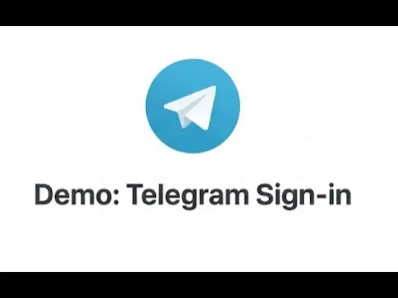 
  <a href="./gallery-and-docs/media/hero.mp4">Original video (mp4)</a>

<!-- LEGAL-TEXT:BEGIN — legally reviewed wording: change only together with LICENSING.md and a new legal review. -->
**Open source under [MPL-2.0](./LICENSE). Free for everyone, in production, at any company size — see [LICENSING.md](./licenses/LICENSING.md).**
<!-- LEGAL-TEXT:END -->

## The idea is simple

**For your users** — passwordless sign-in: scan a QR code or tap a single button, and that is all it
takes to sign in to your app or website.

**For your website or app** — setup on any stack, plus the user's details straight from their messaging app: the name and, depending on the channel, language, photo and
[phone number](https://veriqa.app/docs/guides/phone-number).

With the `channel` scope your website also gets a live channel to the user through their
messaging app, and you don't pay for SMS.

See it working in the [gallery](./gallery-and-docs/).

## How it works

Your users scan the QR code on the sign-in page (on a phone, they tap a button), then confirm the sign-in in their messaging app. Your users can sign in this way on a computer, a TV, a kiosk or any other device that can show a QR code.

  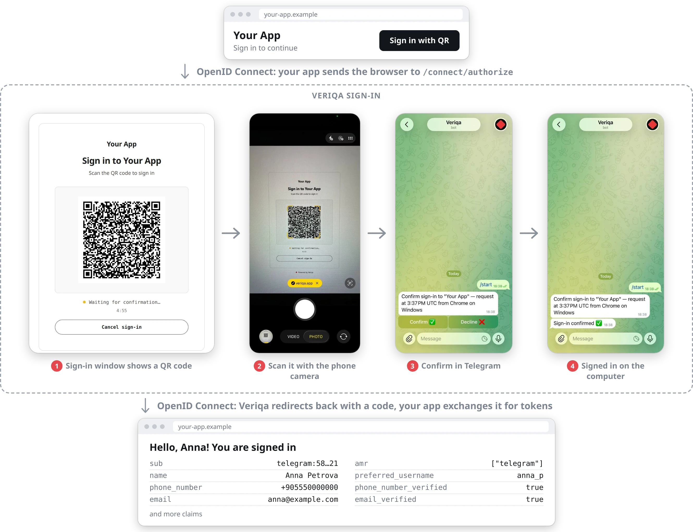 
  Your app starts the sign-in and gets ordinary OpenID Connect tokens back, whichever channel the user picked. In WhatsApp, the user first sends a ready-made message.

  More: <a href="./gallery-and-docs/media/readme/en-telegram-phone.webp">sign-in on a phone</a> ·
  <a href="./gallery-and-docs/media/readme/en-telegram-confirm.webp">confirming an action</a> ·
  <a href="./gallery-and-docs/media/readme/en-telegram-progressive.webp">collecting extra details</a>

You can also use Veriqa to approve AI agent actions and confirm sensitive operations: deleting
important data, changing payment details, granting access to another person.

[**Gallery:** sign-in with Telegram, WhatsApp, Instagram, Messenger and a Google account, step-up and other use cases](./gallery-and-docs/)

- **Easy to embed in your project:** Veriqa is tested with popular CMSs —
  [WordPress](https://veriqa.app/docs/integrations/wordpress),
  [Drupal](https://veriqa.app/docs/integrations/drupal),
  [Joomla](https://veriqa.app/docs/integrations/joomla),
  [TYPO3](https://veriqa.app/docs/integrations/typo3) and
  [Bitrix](https://veriqa.app/docs/integrations/bitrix) — and with enterprise systems:
  GitLab, Keycloak, Grafana, Nextcloud, Discourse, Odoo and Moodle
  ([Veriqa in other applications](https://veriqa.app/docs/integrations/apps)).
- **Any stack:** it works with [.NET](https://veriqa.app/docs/quickstart/dotnet),
  [Node](https://veriqa.app/docs/quickstart/node), [Python](https://veriqa.app/docs/quickstart/python),
  [Java](https://veriqa.app/docs/quickstart/java), Go, PHP and any other stack with an OpenID
  Connect library.
- **Easy to deploy:** a NuGet package, a Docker image or a self-contained archive for Linux and
  Windows — see [Deployment](#deployment).
- **Easy to extend:** you can
  [write a channel in any language](https://veriqa.app/docs/guides/http-channel-adapter) for your
  corporate messaging app or bot and plug it in without changing the core.

## Beyond messaging apps: email and account services

**One-tap email.** Besides a code from an email and a magic link, Veriqa supports sign-in the other
way around: the user scans a QR code, the phone opens an email already filled in with a secret token,
and all that is left is to tap Send. There is nothing to type and nothing to wait for, so no spam
folder and no delayed email. Sending it proves that the user controls the mailbox: the sender is
checked against DMARC. Corporate email security tools open links in incoming email, but the email the user sends contains no links.
[How sign-in by email works](https://veriqa.app/docs/guides/email)

**Google, Apple and 80+ other account services.** The flow is the same as with messaging apps: the
screen shows a QR code, and the user confirms on their own phone, where they are usually signed in to
their account already. The usual "Sign in with Google" button asks for the password on the device
the user signs in on. With a QR code the password is never typed there, so malware on it has nothing
to intercept. Users can sign in this way on a TV or a shared or work computer, and users without a messaging app can sign in too.
[Sign-in with account services](https://veriqa.app/docs/guides/account-services)

## Get started

**Try a channel.** Each quickstart repository is a ready-to-run
passwordless auth setup: Veriqa with just that channel enabled (in Docker, for simplicity), plus minimal OpenID Connect
clients on Python, Node.js, Go, PHP and ASP.NET Core that show the claims after sign-in. The clients are plain OIDC, so the same server works for
any stack.

- [Login with Telegram — Telegram authentication over OpenID Connect](https://github.com/veriqa/telegram-passwordless-login)
- [WhatsApp login and authentication](https://github.com/veriqa/whatsapp-passwordless-login)
- [Passwordless email login](https://github.com/veriqa/email-passwordless-login)

The same samples live in this repository under [`samples/quickstart/`](./samples/quickstart/).
For a deployment, start with the [self-hosted quickstart](https://veriqa.app/docs/quickstart/self-hosted),
or see [INSTALL.md](./gallery-and-docs/INSTALL.md) for all three ways to deploy.

## What you get

**For your users**

- **Nothing to type to sign in.** No password, no SMS code, no sign-up form. A short form appears
  only if your app needs details the messaging app doesn't provide.
- **Nothing to install or remember.** The messaging app is already on their phone.
- **The same on any device.** Your users scan the QR code on the sign-in page (on a phone, they tap
  a button), and the confirmation is the same everywhere: a button in the messaging app. In WhatsApp
  it is one tap to send a ready-made message, and one more if confirmation is on. Your users can sign
  in this way on a computer, a TV, a kiosk or any other device that can show a QR code.

**For your product**

- **Higher sign-in conversion.** Every extra step loses people: on average 70% of online
  shopping carts are abandoned, and among US shoppers who abandon checkout, 18% leave because the site
  demanded an account and 17% because it took too long.[^baymard] 42% of people abandoned a
  purchase in the past month because they could not remember a password.[^fido-barometer]
  Instead of a password, an SMS code and switching between screens, the user takes a few familiar steps on their phone. Sign-in or sign-up takes up to 6 seconds, and that covers every step: pointing the camera, tapping the link and confirming in the messaging app.
- **Sign-in without SMS charges.** SMS is billed per message. Sign-in and confirmation through Veriqa don't use SMS.
- **A live channel instead of a "dead" address.** Along with the sign-in, your product gets a
  connected messaging channel — for notifications, confirmations and other service messages.
- **No frontend SDK.** No Veriqa code in your frontend for sign-in: your application connects to Veriqa as an ordinary OpenID Connect client.
- **Account recovery.** After "Forgot password", the user recovers access through a linked trusted channel, without a chain of emails and codes.
- **Less personal data at rest.** Veriqa ships no user directory. The name, phone number and other
  profile data travel with the sign-in transaction, which lives for minutes, and go into the issued tokens, whose records are deleted after the tokens expire. A permanent store for them exists only if you turn one on. What is stored, where and for how long is covered in [Security and data handling](https://veriqa.app/docs/guides/data-handling).

## Use cases

Each use case points to a runnable sample in this repository or, where it is the same authorize request with different parameters, to its recipe in the documentation.

- **Passwordless authentication.** Your website or app shows a QR code, and the user confirms the
  sign-in in their messaging app — no password needed. A new user signs up with the same action,
  with no form and no CAPTCHA: the confirmation in the messaging app itself keeps bots out.
  Samples: [`samples/dotnet/inproc/login`](./samples/dotnet/inproc/login/) (Veriqa inside your
  host) and [`samples/dotnet/inproc/login-client`](./samples/dotnet/inproc/login-client/) (a
  relying party that only knows OIDC); for other stacks, the
  [quickstarts](https://veriqa.app/docs/quickstart/self-hosted) for Node, Java and Python.
- **AI agents: a human approves the risky step.** Before an AI agent calls a tool or receives
  access, it asks a human for approval. The request arrives in the user's own messaging app, which the agent does not control. With the audit trail switched on, the answer is recorded in it. Samples:
  [`samples/dotnet/inproc/agent-approval`](./samples/dotnet/inproc/agent-approval/) and a ready-made plugin for Claude Code, [`samples/claude-code`](./samples/claude-code/).
- **A direct channel to the user.** The user signs in through a messaging app or email, and with the same action your product gets a live channel to them — Telegram, WhatsApp, another messaging app or Email,
  depending on where they confirmed. Recipe:
  [Sign-in and channel linking](https://veriqa.app/docs/scenarios/channel-linking).
- **Replacing SMS codes.** Instead of typing a code from an SMS, the user confirms the sign-in
  with a button in their messaging app. You pay no SMS charges and get full authentication
  rather than just a delivered code. Recipe:
  [Replacing SMS codes](https://veriqa.app/docs/scenarios/sms-replacement).
- **Leads and feedback without CAPTCHA.** Before submitting a form, a visitor verifies themselves
  through a messaging app in a few seconds. Your site gets a verified contact and a live channel
  instead of a "dead" address typed into a field. It takes a small server-side handler on your site. This use case has been tested with Telegram. Recipe:
  [Leads and feedback without CAPTCHA](https://veriqa.app/docs/scenarios/lead-capture).
- **Second factor, step-up and action confirmations.** When a user does something sensitive —
  deletes important data, changes payment details, grants someone else access — your product asks
  them to confirm it with a single tap in their messaging app, with no code to type. Sample:
  [`samples/dotnet/inproc/step-up`](./samples/dotnet/inproc/step-up/), which also checks that the
  person who confirmed is the account owner.
- **Sign-in on surfaces with no keyboard.** A smart TV, a set-top box, a kiosk: the screen shows
  the QR code and waits for the outcome, and the user types nothing at all. Where the surface has
  a browser or a webview, the usual flow applies. Where it has none, the application's
  backend creates a confirmation and exchanges the confirmed transaction for the user's
  `id_token` — sample: [`samples/dotnet/inproc/confirmation`](./samples/dotnet/inproc/confirmation/);
  the surface-by-surface table is in
  [Sign-in surfaces](https://veriqa.app/docs/scenarios/surfaces).

All use cases, including [account recovery](https://veriqa.app/docs/scenarios/account-recovery),
are in [the overview](https://veriqa.app/docs/scenarios/overview).

<strong>Claude Code mod</strong> — an AI agent's action waits for a person's approval in a messaging app

A ready-made [Claude Code plugin](./samples/claude-code/) stops chosen agent actions until a person
approves them in a messaging app — and, with the audit trail switched on, every approval, refusal and expiry is recorded in it.

<table align="center">
  <tr>
    <td><a href="./gallery-and-docs/media/claude-code-1.webp">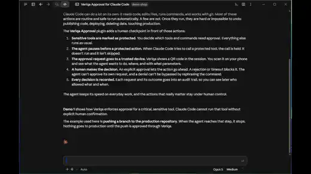</a></td>
    <td><a href="./gallery-and-docs/media/claude-code-2.webp">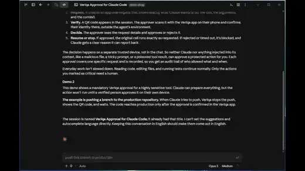</a></td>
    <td><a href="./gallery-and-docs/media/claude-code-3.webp">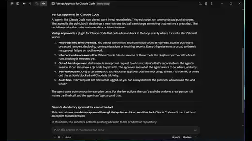</a></td>
  </tr>
  <tr>
    <td align="center">A tool call — <code>git push</code>, <code>rm -r</code> · <a href="./gallery-and-docs/media/claude-code-1.mp4">mp4</a></td>
    <td align="center">The start of a long command cycle · <a href="./gallery-and-docs/media/claude-code-2.mp4">mp4</a></td>
    <td align="center">A costly run — two approvers in turn · <a href="./gallery-and-docs/media/claude-code-3.mp4">mp4</a></td>
  </tr>
</table>

<strong>Sign-in and step-up on every surface</strong> — a TV, a desktop and a phone

<table align="center">
  <tr>
    <th></th>
    <th>Sign-in and sign-up</th>
    <th>Step-up</th>
  </tr>
  <tr>
    <th>TV recorded on a real TV</th>
    <td align="center"><a href="./gallery-and-docs/media/tv-sign-in.webp">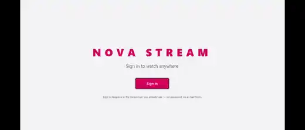</a> <a href="./gallery-and-docs/media/tv-sign-in.mp4">mp4</a></td>
    <td align="center"><a href="./gallery-and-docs/media/tv-step-up.webp">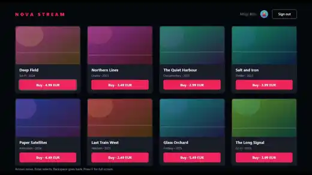</a> <a href="./gallery-and-docs/media/tv-step-up.mp4">mp4</a></td>
  </tr>
  <tr>
    <th>Desktop</th>
    <td align="center"><a href="./gallery-and-docs/media/desktop-sign-in.webp">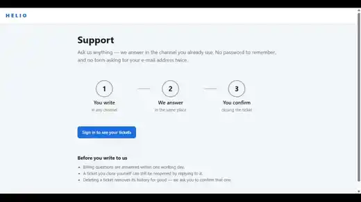</a> <a href="./gallery-and-docs/media/desktop-sign-in.mp4">mp4</a></td>
    <td align="center"><a href="./gallery-and-docs/media/desktop-step-up.webp">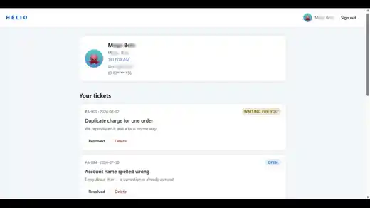</a> <a href="./gallery-and-docs/media/desktop-step-up.mp4">mp4</a></td>
  </tr>
  <tr>
    <th>Mobile</th>
    <td align="center"><a href="./gallery-and-docs/media/mobile-sign-in.webp">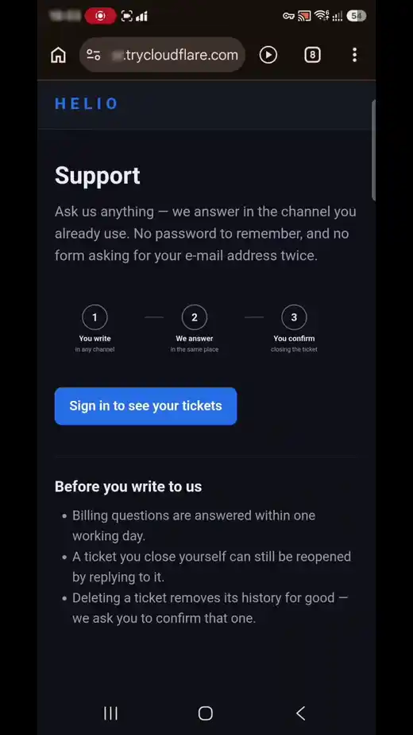</a> <a href="./gallery-and-docs/media/mobile-sign-in.mp4">mp4</a></td>
    <td align="center"><a href="./gallery-and-docs/media/mobile-step-up.webp">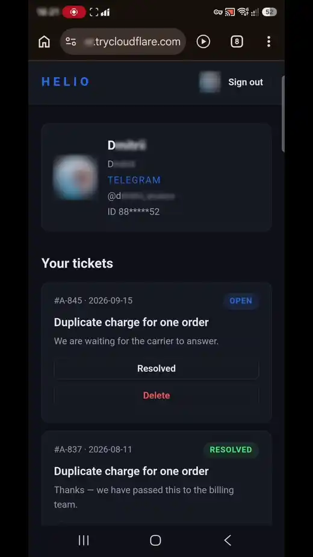</a> <a href="./gallery-and-docs/media/mobile-step-up.mp4">mp4</a></td>
  </tr>
</table>

## Sign-in methods compared

| Sign-in method | Setup: hands-on time | First sign-in | Repeat sign-in | Contact channel |
|---|---|---|---|---|
| Password | hours | email, the password twice, a confirmation link in the mailbox | ~30 s, ~69 s with a second factor[^microsoft] | Email, if confirmed |
| SMS code | hours of work and days of waiting | phone number, wait for the SMS, type the code | ~17 s | SMS to a phone number — every message is billed |
| Social sign-in | hours for each provider, plus waiting for app review | 30 s | 3.4 s | Usually email |
| Passkey | minutes, hours with the fallback sign-in | create an account another way first, then create the key; 24 s with the key on the phone | 3–15 s,[^microsoft][^passkey-index][^google] 18 s with the key on the phone | None |
| **Veriqa** | **15–30 minutes** | **4–6 s** | **4–6 s** | **The messaging app, already connected** |

The Veriqa times are our own measurements in Telegram, for a sign-in with confirmation; automatic sign-in takes 2.4–3.5 s. In other messaging apps the time may differ, and the 15–30 minutes assume a Telegram bot.
The source of every figure, what the user does step by step and how the setup was assessed are in
the [full comparison](https://veriqa.app/docs/concepts/sign-in-comparison). How Veriqa
fundamentally differs from passkeys, sign-in widgets built into messaging apps, SMS codes and the
device flow is covered [separately](https://veriqa.app/docs/concepts/comparison).

Telegram and other messaging apps have free sign-in widgets of their own. The difference isn't price. Veriqa gives you one integration layer for all channels and email instead of a widget per messaging app, and standard OpenID Connect instead of a JS widget: tokens and claims your application can use to link accounts. The
messaging app need not be on the device the person signs in from, and beyond sign-in you get a
second factor, channel linking and an audit trail.

## Architecture

Veriqa is a bridge between your application and the user's trusted messaging app. It opens a
sign-in or confirmation transaction, binds it to the chosen channel, waits for the user's
confirmation and hands the result back — as tokens for the sign-in, or as an outcome to your
backend.

- **Transaction orchestration.** A sign-in is a transaction with an explicit state, a lifetime and
  a single outcome. It survives a change of device, expires on its own, handles repeated requests idempotently and, with the audit trail switched on, is recorded in it.
- **Confirmations without a sign-in.** Your backend can ask a person to confirm an action — a payment, a device, a data transfer — directly, server to server: it creates the
  transaction, shows the QR code, reads the outcome and can check that the account owner was the
  one who confirmed. The contract is the
  [server-to-server confirmation API](https://veriqa.app/docs/reference/confirmation-api).
- **Channel adapters.** Telegram, WhatsApp, Email and others are switched on by configuration. A
  channel of your own needs no change to the core, and it does not have to be .NET: it can be an external service in any language over HTTP. To use a bot you already run, see [You already have a bot](https://veriqa.app/docs/guides/existing-bot).
- **Integration.** Any stack, standard OIDC: Veriqa is an OpenID Connect provider for any application, .NET included. On .NET it can also run inside your host as a connector on top of OpenIddict. In an IAM such as Logto
  it is added as an ordinary social connector.
- **Settings per application.** Channels, sign-in page text and branding, policies and limits are all configuration, with four levels of ownership, from the core to the application, and a defined resolution order.
  One installation serves many applications, each with its own settings.
- **Audit trail.** The audit trail is off by default; you switch it on and set
  its rules. Identities are always masked in it, and tokens are written neither to the log nor to the audit trail.
- **Stack.** .NET 10, shipped as NuGet packages, a Docker image and self-contained archives for
  Linux and Windows. Storage in memory, EF Core (PostgreSQL, SQL Server and others) or Redis. The sign-in page is plain JS with a bundled SignalR client: no frameworks, nothing loaded from third-party servers by default. No telemetry and no calls to the vendor: outbound traffic goes only to what you connect — messaging apps, account services, your mail server and your own services.
- **Security.** The risks of each sign-in method — an infected computer, a phishing site, a hijacked phone number or account, a database leak — are laid out in the
  [risk table](https://veriqa.app/docs/concepts/sign-in-comparison#risks-and-capabilities). What
  Veriqa collects and where it stores it is in
  [Security and data handling](https://veriqa.app/docs/guides/data-handling), and the production
  setup is in [Preparing for production](https://veriqa.app/docs/guides/hardening). The first public release came out on September 23, 2026, and there has been no independent security audit yet; the code has been audited repeatedly by AI agents. What the
  product does not do yet is in [Known limitations](https://veriqa.app/docs/reference/limitations).

Details are in [Architecture](https://veriqa.app/docs/concepts/architecture).

## Deployment

| Mode | What it is | Start here |
|---|---|---|
| **Embedded (NuGet)** | Inside your ASP.NET Core host as an OpenIddict connector — no separate service to operate | [.NET quickstart](https://veriqa.app/docs/quickstart/dotnet) |
| **Standalone (Docker)** | Its own OIDC server in a container; your application, on any stack, doesn't reference any Veriqa package, so nothing enters your build or your SBOM | [Self-hosted quickstart](https://veriqa.app/docs/quickstart/self-hosted) |
| **OS service (archive)** | The same standalone server without a container — a systemd unit or a Windows service; no Docker and no .NET runtime needed | [Install as an OS service](https://veriqa.app/docs/quickstart/os-service) |

All three are covered in [INSTALL.md](./gallery-and-docs/INSTALL.md). In embedded mode Veriqa **extends** the
OpenIddict setup of your ASP.NET Core application rather than replacing it: it runs the sign-in
transaction between `/connect/authorize` and `/connect/token` and leaves token issuance to
OpenIddict. In the other modes your application never touches OpenIddict, which runs inside the Veriqa server: the application talks to that server over plain OpenID Connect.

Veriqa Cloud, the hosted version, opens soon; its API contract is described in
[Cloud](https://veriqa.app/docs/cloud/overview). Until then, run the standalone server.

## Channels

| Channel | Status | Quickstart repository |
|---|---|---|
| Telegram | built in | [telegram-passwordless-login](https://github.com/veriqa/telegram-passwordless-login) |
| WhatsApp (Meta Cloud API or Twilio) | built in | [whatsapp-passwordless-login](https://github.com/veriqa/whatsapp-passwordless-login) |
| MAX | built in | [max-passwordless-login](https://github.com/veriqa/max-passwordless-login) |
| Instagram | built in — signing in users outside your own team needs access granted by Meta | |
| Messenger | built in — signing in users outside your own team needs access granted by Meta | |
| WeChat | built in — needs a verified Service Account | |
| Viber | built in — tested only against a mock of the Bot API, not verified on the live platform; new bots are issued by Viber on commercial terms ([setup and caveats](https://veriqa.app/docs/guides/channels#viber)) | |
| Google, Apple, Huawei, Yandex, VK ID and other provider accounts | built in — the `Veriqa.Core.ChannelAdapter.WebProviders` package; each client you register with a provider is a separate channel ([setup](https://veriqa.app/docs/guides/channels#sign-in-with-a-provider-account), [scenario](https://veriqa.app/docs/scenarios/provider-account-sign-in)) | |
| Email (one-tap email, code from an email and magic link) | built in | [email-passwordless-login](https://github.com/veriqa/email-passwordless-login) |

Any other channel — a corporate messaging app, a bot of your own, a regional platform — connects
as an [HTTP channel](https://veriqa.app/docs/guides/http-channel-adapter) written in any language,
or as a .NET adapter built against the MIT-licensed `Veriqa.Core.Contracts` package (see
[`samples/dotnet/custom-channel`](./samples/dotnet/custom-channel/)). Adapters for LINE, Slack,
Microsoft Teams, Discord, Zalo, KakaoTalk and Threema are already implemented and live in the
`channel-adapters` repository ([source code](https://veriqa.app/source)). The full list, with the
status and claims of each channel, is in
[Supported messaging apps](https://veriqa.app/docs/guides/supported-channels) and on the
[website's channels page](https://veriqa.app/channels). Pseudonymized channel identifiers and the rest of what the next releases bring are described in
[Coming next](https://veriqa.app/docs/releases/next).

Email works three ways: the **one-tap email**, a **code from an email** and a **magic link**. You
can offer them side by side and choose which one the sign-in page offers first. How they differ is
in [Sign-in by email](https://veriqa.app/docs/guides/email); which one to pick, in
[Which mode to choose](https://veriqa.app/docs/guides/channels#which-mode-to-choose).

## FAQ

**Does the user need to install a separate app?**
No. The user confirms the sign-in in a messaging app they already have; there is no separate
authenticator to install.

**What if the user doesn't have Telegram or WhatsApp?**
There are other messaging apps, email and sign-in with a Google, Apple or other account: the user picks what they have.

**Does Veriqa replace our auth system?**
No. Keep the sign-in methods you already have and add sign-in through Veriqa alongside them. Who
issues the tokens depends on how you deploy it:
- **inside a .NET application**, Veriqa extends your OpenIddict, and OpenIddict issues the tokens;
- **as a standalone server**, Veriqa issues the tokens itself as an OpenID Connect provider, and
  your application on any stack stays an ordinary OIDC client;
- **behind an IAM** such as Keycloak or Logto, Veriqa is connected as an external identity
  provider, and the IAM still owns the accounts.

**Does Veriqa replace OpenIddict?**
No — and this question only concerns embedded mode on .NET. There Veriqa is a connector on top of OpenIddict, which stays the foundation of authentication. In the other modes your application never touches OpenIddict, which runs inside the Veriqa server.

**How does it differ from passkeys, and is it safer?**
Passkeys are phishing-resistant by design, so they are safer. Veriqa fits where phishing resistance by design isn't required. It also works where cross-device passkeys break: with Bluetooth off, in a VM, over remote desktop.

**Is the sign-in phishing-resistant?**
Not fully. A fake site can show the user the real QR code, and if the user confirms, the attacker's
browser is signed in. That is why the message in the messaging app names the application, the
browser and, where known, the region the request came from: they show the user that someone else
started it. Where you need phishing resistance by design, use passkeys.

**How much does a sign-in cost compared with an SMS code?**
You stop paying for SMS. Telegram does not charge for bot messages. In WhatsApp, Meta has billed service replies since October 1, 2026, after 1,000 free messages per business number per month, and if you connect through Twilio, its own per-message fee comes on top.

More answers in the [documentation](https://veriqa.app/docs).

## Documentation · Demo · Contact

- [Documentation](https://veriqa.app/docs) — quickstarts, concepts, configuration reference.
- [Live examples](https://veriqa.app/demo?lang=en) — sign in through a messaging app in a minute.
- [Contact](https://veriqa.app/contacts) — questions about integration, a pilot or the roadmap.

## Contributing · Security · License

- [CONTRIBUTING.md](./CONTRIBUTING.md) — how to contribute (the CLA is accepted once, by
  email, and covers every Veriqa repository; third-party channel adapters built against the MIT
  `Veriqa.Core.Contracts` package need no CLA).
- [SECURITY.md](./SECURITY.md) — responsible disclosure. Please do not open public issues for
  vulnerabilities.
- [CODE_OF_CONDUCT.md](./CODE_OF_CONDUCT.md) — adapted from Contributor Covenant v2.1.
- [LICENSING.md](./licenses/LICENSING.md) — the license map, the licensing FAQ, and links to the
  trademark policy and the terms of the paid offerings: white-label builds, Veriqa Cloud and
  contractual support.

[^baymard]: Baymard Institute, [Cart Abandonment Rate Statistics](https://baymard.com/lists/cart-abandonment-rate): 70.22% average documented cart abandonment across 50 studies; reasons among shoppers who abandoned a checkout, excluding those who were just browsing.
[^microsoft]: Microsoft Learn, [Passkeys (FIDO2) authentication method in Microsoft Entra ID](https://learn.microsoft.com/en-us/entra/identity/authentication/concept-authentication-passkeys-fido2): signing in with a synced passkey takes 3 seconds, versus 69 seconds for a password with a traditional second factor; data on Microsoft consumer accounts.
[^passkey-index]: FIDO Alliance, [Passkey Index](https://fidoalliance.org/fido-alliance-launches-passkey-index-revealing-significant-passkey-uptake-and-business-benefits/), October 2025: a passkey sign-in takes 8.5 seconds on average; data reported by nine member companies of the alliance.
[^google]: Google Security Blog, [Making authentication faster than ever: passkeys vs. passwords](https://security.googleblog.com/2023/05/making-authentication-faster-than-ever.html): a passkey sign-in takes 14.9 seconds on average, versus 30.4 seconds with a password; about 100 million sign-ins to Google accounts, March–April 2023.
[^fido-barometer]: FIDO Alliance, [Online Authentication Barometer 2024](https://fidoalliance.org/wp-content/uploads/2024/10/Barometer-Report-Oct-31-2024-2.pdf): 10,000 consumers across ten countries; 42% abandoned a purchase and 56% gave up accessing an online service in the past month because of a forgotten password.
