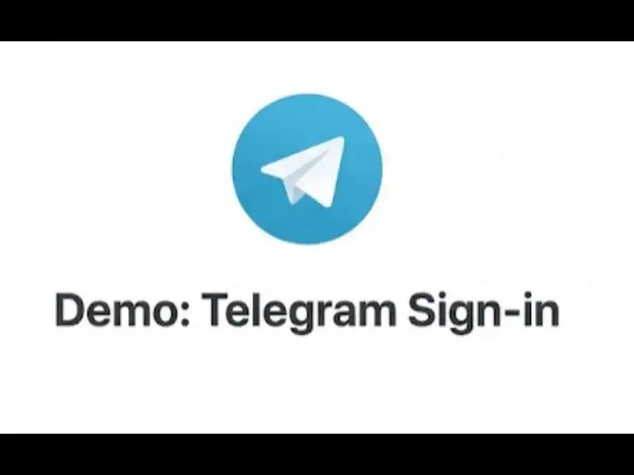

# Veriqa — passwordless login and authorization by QR code via Telegram, WhatsApp, email, Google, Apple and other accounts: no passwords or SMS, self-hosted OpenID Connect

**One QR code or one button instead of forms, passwords and SMS codes.**

The user scans the QR code on your page or taps a button. The messaging app they already have opens
with a message and buttons, and they confirm the sign-in with a single tap. Users can also sign in
through a Google or Apple account and 80+ other services.

* **4–6 seconds** to sign in, even the first time ([measurements](https://veriqa.app/docs/concepts/sign-in-comparison)).
* **7 popular messaging apps** and **one-tap email** built in, plus a Google or Apple account and **80+ other services** ([all channels](https://veriqa.app/docs/messengers-and-accounts)).
* **Open source under MPL-2.0**. Keep the sign-in methods you have and add Veriqa next to them.
* 15–30 minutes to add it to your website.
* **Any stack** with an OpenID Connect library. No frontend SDK needed.
* A standard OpenID Connect identity provider in one container.

Use it for passwordless sign-in, a second factor, confirming sensitive actions and approving AI agent
actions: [all use cases](https://veriqa.app/docs/scenarios/overview).

[**Gallery:** sign-in with Telegram, WhatsApp, Instagram, Messenger and a Google account, step-up and other use cases](https://github.com/veriqa/veriqa/tree/main/gallery-and-docs)



```bash
docker pull veriqa/veriqa
```

## What this image is

The image is the standalone Veriqa server. Your application talks to it over standard OpenID Connect
and needs no Veriqa package, so nothing from Veriqa enters your build or SBOM.

- Platform: `linux/amd64`. On another architecture, [build the image from source](https://veriqa.app/docs/quickstart/self-hosted#1-get-the-image).
- Runs as a non-root user (UID `1654`).
- Exposes port `8080` over HTTP and ships a health check on `/health/live`. Terminate TLS in front of
  the container.

## Tags

- `<version>`, for example `0.6.1`: a specific release. Pin one in production.
- `latest`: the newest release.

## Try it

Each repository below is a local sign-in demo: Veriqa with one channel and a minimal client app that
shows the claims after sign-in.

- [Telegram](https://github.com/veriqa/telegram-passwordless-login)
- [WhatsApp](https://github.com/veriqa/whatsapp-passwordless-login)
- [Email](https://github.com/veriqa/email-passwordless-login)

You can also [try the live examples](https://veriqa.app/demo?lang=en) without installing anything.

## Run it

```bash
docker run -d --name veriqa \
  -p 8080:8080 \
  --env-file veriqa.env \
  -v "$PWD/veriqa.json:/app/config/veriqa.json:ro" \
  veriqa/veriqa:<version>
```

Without a store and token certificates the container does not start, and the log names the missing
setting. A working sign-in needs four things:

- **A store.** Set `Veriqa__OpenIddict__Database__Provider` to `PostgreSQL` or `SqlServer` and supply
  its connection string. Set `Veriqa__TransactionEngine__Store__Provider` and its connection string
  too, so that sign-ins in progress survive a restart.
- **Two token certificates.** Supply a signing PFX and an encryption PFX, as a file path or as Base64.
- **Your OIDC client.** Declare it under `Veriqa:OpenIddict:Clients` in `veriqa.json`.
- **At least one channel.** For example, your Telegram bot token.

The [self-hosted quickstart](https://veriqa.app/docs/quickstart/self-hosted) walks through each step,
from generating the certificates to putting the server behind a reverse proxy.

## Other ways to deploy

- [OS service](https://veriqa.app/docs/quickstart/os-service): the same server as a systemd unit or a
  Windows service, with neither Docker nor a .NET runtime.
- [NuGet connector](https://veriqa.app/docs/quickstart/dotnet): inside your ASP.NET Core host, on top
  of OpenIddict.

## Learn more

- [Documentation](https://veriqa.app/docs)
- [Known limitations](https://veriqa.app/docs/reference/limitations)
- [Source code](https://veriqa.app/source)
- [Contact](https://veriqa.app/contacts)

## License

**Open source under [MPL-2.0](https://github.com/veriqa/veriqa/blob/main/LICENSE). Free for everyone, in production, at any company size — see [LICENSING.md](https://github.com/veriqa/veriqa/blob/main/licenses/LICENSING.md).**
