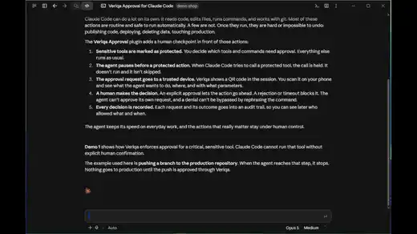
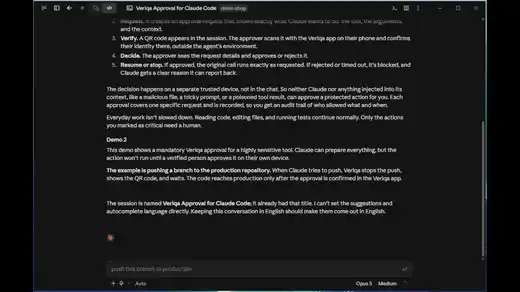
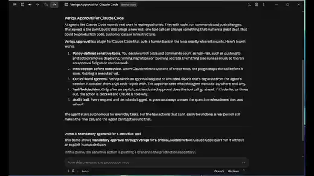

# Veriqa sample — Claude Code · approving agent actions in a messaging app

A Claude Code plugin that stops chosen actions until a person approves them in a messaging app through
Veriqa. It is a **mod**: a plugin of function hooks that runs inside Claude Code itself. The hook holds
the action, shows the QR code in a pane of its own, waits for the answer and lets the action run only
once it is confirmed — the model takes no part in the approval. It works out of the box for three
cases:

| Demo | What is stopped | How | Action type |
|---|---|---|---|
| 1. A tool call | `git push` and `rm -r…` in the Bash or PowerShell tool | `tool.call` hook | `agent-tool-call` |
| 2. The start of a long command cycle | `/cycle`, `/cycle-chain` — typed by you **or** started by the agent | `command.run` hook + `tool.call` on the `Skill` tool | `agent-command-start` |
| 3. A costly run with an estimate | `/veriqa-approval:costly-run` — asks to approve 1 billion input and 50 million output tokens, about 6250 USD, before it starts | the plugin's tool `approve_run` | `agent-costly-run` |

The person reads a wording declared on the Veriqa host, with the values of typed slots filled in:
"For manager: Claude Code in my-project wants to start nightly-refactor, estimated at 1000 M input
and 50 M output tokens, about 6250 USD. Start it?" Free text written by the agent never becomes the
question.

Demo 3 takes **two approvers in turn**: `developer`, then `manager`. Each confirms from their own
messaging app account, enrolled once beforehand, and a confirmation from any other account refuses the
action. Demos 1 and 2 take one approval from whoever holds the link.

<table align="center">
  <tr>
    <td><a href="./media/claude-code-1.webp"></a></td>
    <td><a href="./media/claude-code-2.webp"></a></td>
    <td><a href="./media/claude-code-3.webp"></a></td>
  </tr>
  <tr>
    <td align="center"><sub>1. A tool call — <code>git push</code>, <code>rm -r</code></sub></td>
    <td align="center"><sub>2. The start of a long command cycle</sub></td>
    <td align="center"><sub>3. A costly run — two approvers in turn</sub></td>
  </tr>
</table>

**Claude Code 2.1.295 or later** is needed: the sample relies on the mod API of that build.

## Why this sample exists

The sample shows how Veriqa can be used inside a ready-made agent harness to have a person approve
sensitive agent actions — not only tool calls, but also heavy, costly runs that burn time and
tokens. Veriqa's audit trail can record every approval, refusal and expiry, with the time and, for an
approval, the masked account that gave it. This sample leaves the trail off: it needs
`Veriqa:Logging:Mode` set to `Audit` and a database for the records, see
[Security and data handling](https://veriqa.app/docs/guides/data-handling#the-audit-trail-is-off-until-you-ask-for-it-twice).
This matters most for teams where several developers work with
agents at once.

Claude Code and development tasks are just the example chosen here. The same approach fits another
harness and other tasks: take this sample as a starting point, then rework and adapt it to your
needs — the rules, the action types and their wordings are all yours to change.

Veriqa runs locally in Docker only to make the demo quick to set up. It is not a recommended
deployment: in a team, the approving host is a shared service that everyone's agents call.

### Why not just an "Allow" button in the harness

Claude Code already asks before it runs a tool, and an agent's chat channel can show a button too.
Approving through Veriqa adds what those buttons lack:

- **A named person, not whoever is at the keyboard.** The harness button proves only that someone
  pressed it. With an enrolled approver, the host checks which messaging app account confirmed, and a
  confirmation from any other account refuses the action.
- **Someone other than the developer.** A harness button can only ask the person running the agent.
  A chain can ask a second person — here a manager approves the costly run after the developer — so
  nobody signs off their own spending.
- **A trail outside the agent's session.** The harness keeps its answers in a local transcript that
  the same user can edit or lose. With the audit trail on, Veriqa records every approval, refusal and
  expiry on its own host; with a shared host, that record sits outside the reach of every developer's machine and agent.
- **A question the agent does not write.** In an agent's own chat channel the agent phrases the
  question, and can phrase it misleadingly. Here the wording is declared on the host, and the agent
  supplies only typed values the host checks against the contract.
- **A separate device.** The answer comes from the person's phone, over a channel the agent does not
  control, so it still works when the person is away from the terminal during a long run.
- **One policy across harnesses.** The same action types and approvers serve Claude Code, another
  harness or your own agent code.

For a single developer watching their own agent, the harness button is often enough. The difference
shows when several people share agents, spending or responsibility — and only in the setups that
use it: demos 1 and 2 here take one approval from whoever holds the link, and a local host keeps
the trail on the developer's own machine.

## How it works

```
Claude Code ──tool call / command / prompt──▶ plugin hook ──▶ Veriqa (https://127.0.0.1:8443)
                                                  │  ◀── link and QR ── channel_entry
                         pane with the QR ◀───────┤
                                                  │  ──▶ polls the result ◀── confirmed / declined ◀── person, in the messaging app
             the action runs, or is refused ◀─────┘
```

1. The hook receives the tool call, the slash command or the prompt and looks it up in the rules
   (`rules.default.json`). Nothing matches — Claude Code goes on as usual.
2. A rule matches — the hook creates a confirmation (`POST /api/transaction/confirmation`) with the
   rule's action type and slot values. The action is held; nothing has run.
3. The plugin opens its pane **Veriqa approval (sample)**: what is asked, the QR code Veriqa returned,
   the link and how long it is valid. You scan the code and answer in the messaging app.
4. The hook polls `GET /api/transaction/{id}/result` every two seconds, longer when the host asks it
   to slow down. It waits with a short host command between reads (`sleep`, or `Start-Sleep` in
   PowerShell on Windows), because the time a hook spends in such a call is not taken from its
   ten-second budget. The wait lasts as long as the transaction lives (`ttl_seconds`, up to 30
   minutes) and 15 seconds more.
5. `confirmed` — the action runs, or, in a chain, the next approver is asked. The model reads a note
   after the result that a person approved the action: the wait looks to it like a slow call.
   Anything else **refuses it**: declined, expired, refused in the pane, the turn interrupted,
   confirmed by an account other than the enrolled approver, Veriqa unreachable, a request the host
   rejected, the plugin not configured. The gate never lets an action through because something
   failed: every hook has a `.catch` handler that refuses when the hook itself fails.

### How the approval is shown

- **The pane.** One pane, `veriqa-approval`, holds every approval in progress, one under another,
  each with a **Refuse** button. In a terminal the QR code is drawn in block characters, black on
  white whatever the theme; in the desktop app, the IDE extension and the mobile app it is a
  picture. The pane closes when the last approval ends.
- **A narrow terminal.** Claude Code places a pane that opened by itself only from 144 columns (110
  once you have opened it before). Below that the plugin's status line says what is waited for and
  `type /veriqa-approval to show the code`; the command opens the pane at any width and runs at once,
  while the approval holds the turn; a line in the transcript says the same. A pane narrower than the
  code says so instead of drawing it.
- **The status line** names the step: `Veriqa: waiting for manager (2 of 2)`.
- **No QR.** When the host draws no code (the address does not fit) or the picture cannot be read,
  the pane shows the link alone.

The QR code is read back from the PNG the host returns, not encoded by the plugin: with hop mode the
code carries a hop link, not the address the response names as `url`.

### Approval chains

An action type listed under `chains` in the rules needs every approver of its list, in order:

```json
"chains": {
  "agent-costly-run": ["developer", "manager"]
}
```

- **Every approver is checked before anything is asked.** A missing approver, or two names enrolled
  with one account, refuses the action before the first transaction is created.
- **Every step is a transaction of its own** that names the expected account in
  `expected_identities` and keeps to that account's messaging app (`allowed_channel_types`). The next
  step is created only after the previous one is confirmed, and the pane's QR changes to it.
- **The gate checks who confirmed.** Veriqa answers with `matched_type`, the identity type that
  matched, and it does not refuse a mismatch by itself: a step confirmed by somebody else still ends
  `confirmed`. The plugin refuses unless `matched_type` is `channel_user_id`.
- **Veriqa does not deliver the question to the second person.** The link is a bearer one and goes
  nowhere by itself. For the demo, the pane shows the step 2 code too and says so; in a real setup
  the link reaches that person another way — their own chat, e-mail, a ticket. If somebody else
  opens it and confirms, the check above refuses.

An action type without a chain keeps one approval from whoever holds the link.

## Channels

The sample asks in one channel, or lets the person pick one on the phone — the `channel` setting:

| `channel` | Where the person answers | What the host needs |
|---|---|---|
| `telegram` (default) | Telegram | a bot token; the host uses long polling, so it works on `localhost` |
| `messenger`, `whatsapp`, `instagram` | that Meta channel | the channel enabled in `host/veriqa.json`, and the host on a public HTTPS address: Meta delivers the answer by webhook |
| `hop` | the channel the person picks on a page the QR opens | `HopMode.Enabled: true` in the client entry, `Veriqa:OpenIddict:Server:Issuer` set to that public HTTPS address, and at least one channel besides Telegram enabled — with only one channel the host returns its direct link |

With `hop` the phone opens the link, so the host has to be reachable from the phone as well.

## What you need

- Claude Code 2.1.295 or later.
- [Docker](https://docs.docker.com/get-docker/) with Compose: the local host runs in it from the
  published image `veriqa/veriqa`. Without Docker, install Veriqa
  [as an OS service](https://veriqa.app/docs/quickstart/os-service) and give it the same settings, or
  point the plugin at the [Shared stand](#shared-stand), which needs nothing installed.
- A Telegram bot token from [@BotFather](https://t.me/BotFather). If the bot has a webhook set,
  remove it first (`https://api.telegram.org/bot<token>/deleteWebhook`), otherwise polling gets
  `409 Conflict`. Use a bot no other server polls: Telegram hands the updates to one poller only.

Everything below runs in this sample's [`host/`](host/) folder:

```
host/
  docker-compose.yml   Veriqa from the published image at https://127.0.0.1:8443
  veriqa.json          the client entry claude-code, its action types and the channels
  .env.example         the values you fill in
```

## 1. Fill in the settings and create the certificate

```bash
cd host
cp .env.example .env
```

Put your bot token into `TELEGRAM_BOT_TOKEN`, a long random string into `CLIENT_SECRET` (the plugin
asks for the same value in step 3) and any password into `CERT_PASSWORD`.

The token endpoint accepts HTTPS only. Let the stand create a self-signed certificate for `localhost`
and `127.0.0.1`:

```bash
docker compose run --rm certificate
```

`certs/localhost.pfx` goes to the host. `certs/localhost.crt` stays with Claude Code. The plugin has no
setting for a certificate to trust: its requests go through Claude Code, so Claude Code itself has
to trust it. Start Claude Code from an environment where `NODE_EXTRA_CA_CERTS` names the
file:

```bash
NODE_EXTRA_CA_CERTS=<path to this folder>/host/certs/localhost.crt claude
```

On Windows, set it as a user environment variable before you start Claude Code or the desktop app.

## 2. Start the host

```bash
docker compose up -d
docker compose ps
```

Wait until the status reads `healthy`, then check the host from this machine:

```bash
curl --cacert certs/localhost.crt https://127.0.0.1:8443/health/ready
```

`docker-compose.yml` publishes the port on `127.0.0.1` only and passes the bot token and the client
secret from `.env`. The rest of the settings are in [`host/veriqa.json`](host/veriqa.json), which the
image reads from `/app/config/veriqa.json`. To use the other channels, edit it, then restart with
`docker compose up -d --force-recreate`:

| Key | Value |
|---|---|
| `Veriqa:Channels:Messenger`, `WhatsApp`, `Instagram` | only for those channels: replace their `REPLACE_ME` credentials and set `Enabled: true` |
| `Veriqa:OpenIddict:Server:Issuer` | only for `hop`: the host's public HTTPS address. Left empty, the host uses its own address |

What `veriqa.json` declares:

- Telegram enabled on long polling; Messenger, WhatsApp (`MetaCloudApi`) and Instagram present but
  disabled, so a host that needs only Telegram starts without their credentials.
- the client `claude-code` with `AllowClientCredentials` and, in its `MessageTemplates`, the three
  action types with their slots and wordings, plus `agent-approver-enroll` for enrolling approvers.
  `AllowConfirmationTokenGrant` with the scopes `openid` and `channel` lets the plugin learn, once
  per enrolment, which messaging app account confirmed; `IdentityMatchComparableTypes` declares
  `channel_user_id`, the identity each step of a chain is checked against. An action type has to be
  declared **in the client entry**; the host section `Veriqa:MessageTemplates` only holds the
  receipts of the outcome. `HopMode` (off, `QrMode: Unified`) is what `hop` turns on: the QR then
  leads to a page where the person picks the channel.
- `OutcomeNotice:DisplayIntent: NewMessage` — the answer arrives as a new message and the question
  stays readable above it.

The host runs in the `Development` environment: issued tokens live in memory and are signed with
development certificates, so they are lost on restart, and the plugin gets a new token on its own.
The plugin, not the host, keeps the enrolled approvers. It is a local host, not a deployment.

To use a Veriqa host of your own instead, add the `claude-code` entry from `veriqa.json` to its own
`Clients` array. Configuration files merge arrays by index, so a second file with its own
`Clients:[0]` would overwrite fields of your first client instead of adding a new one.

## 3. Install the plugin

In a Claude Code terminal session, add the folder that holds this README as a marketplace:

```
/plugin marketplace add <path to this folder>
/plugin install veriqa-approval@veriqa-samples
```

The install asks for the plugin's settings. The client secret is kept in secure storage, the rest in
`settings.json` under `pluginConfigs`; every setting but the secret is a row in `/config` afterwards.

| Setting | Default | Meaning |
|---|---|---|
| `mode` | `own-host` | `own-host` — your own Veriqa host. `shared-stand` — the shared stand, see [Shared stand](#shared-stand) |
| `host_url` | `https://127.0.0.1:8443` | Address of your host (`own-host`) |
| `client_id` | `claude-code` | `ClientId` of the entry in `host/veriqa.json` |
| `client_secret` | — | The client's secret, `CLIENT_SECRET` from `host/.env` (`own-host`) |
| `stand_url` | empty | Address of the shared stand's facade (`shared-stand`); no default |
| `channel` | `telegram` | `telegram`, `messenger`, `whatsapp`, `instagram` or `hop` — see [Channels](#channels) |
| `ttl_seconds` | `300` | How long each approver has to answer, 60…1800; the hook waits that long |
| `locale` | empty | Language of the question, a BCP 47 tag; empty — the host's default |
| `rules_file` | empty | A rules file to use instead of the default — see [Rules](#rules) |
| `price_input` | `5` | USD per million input tokens, for the cost in demo 3. The default is the Claude Opus 5 list price |
| `price_output` | `25` | USD per million output tokens, the same |

> **The plugin refuses what it guards until it is configured.** Installed without a secret, it
> stops `git push`, `rm -r…`, `/cycle` and `/cycle-chain` with "Veriqa is not configured". That is
> the fail-closed rule, not an error.

## 4. Enroll the approvers

Demo 3 needs two people with two messaging app accounts. Enroll each of them once, in Claude Code:

```
/veriqa-enroll developer
/veriqa-enroll manager
```

Each command opens the pane with a QR. The person to be enrolled scans it with their own phone and
confirms "register this messenger account as the approver …"; the command then answers
`ENROLLED: …`. Whoever confirms is enrolled, so the link has to reach exactly that person: if it
went to someone else, interrupt the turn (Esc) or press Refuse, and nobody is enrolled. The
accounts are kept in the plugin's own store, separately for every host or stand address: an account
of one bot is no use to another. Enrolling a name again replaces its account.

Until both are enrolled, demo 3 is refused with "the approver … is not enrolled". To try it alone,
remove `chains` from a copy of the rules (see [Rules](#rules)).

## 5. Try the three demos

1. **A tool call.** Ask Claude to push the current branch. Before `git push` runs, the pane shows a
   QR. Scan it and answer in the messaging app: confirming lets the push run, declining returns the
   refusal to Claude.
2. **A command cycle.** Type `/cycle TASK-1` (or any command listed in the rules). The pane shows a
   QR before the command starts; declined, the command does not run and its output is the reason.
   If the agent itself decides to start `/cycle` through the Skill tool, the same question is asked,
   with `started_by: agent`.
3. **A costly run.** Type `/veriqa-approval:costly-run nightly refactor`. The command estimates the
   run (the demo estimate is 1 billion input and 50 million output tokens) and calls the plugin's
   tool `approve_run` once; the run starts only when the tool succeeds. `input=` and `output=` in the
   arguments, in millions of tokens, replace the estimate. The question also names the cost in whole
   USD, which the plugin computes from the estimate and the prices above: 1000 × 5 + 50 × 25 = 6250
   USD. It is a list-price ceiling: prompt caching and batch discounts make a real run cheaper, and
   the plugin does not guess how much. Two approvers answer in turn: the pane shows the QR for
   `developer`, then, once developer has confirmed, the QR for `manager` — scan it from the
   manager's account.

## Rules

The rules are looked up in this order: the file in `rules_file`, then
`.claude/veriqa-approval.rules.json` in the project, then `rules.default.json` of the plugin. The first
matching rule wins.

On Windows Claude Code runs commands with the PowerShell tool, not Bash, so the default rules name
both tools, and the delete rule also catches `Remove-Item -Recurse`. A rule of your own for shell
commands should name both too.

```json
{
  "id": "git-push",
  "event": "tool.call",
  "tool": "^(Bash|PowerShell)$",
  "input": { "command": "\\bgit\\s+push\\b" },
  "action_type": "agent-tool-call",
  "slots": {
    "action": "push the branch to the remote repository",
    "tool": "{tool}", "target": "{input.command}", "project": "{project}"
  }
}
```

The person reads what is being done first — "Claude Code in my-project wants to push the branch to
the remote repository" — and the command only as a detail below it: `action` is a fixed phrase of
the rule, not text from the agent.

| Member | Meaning |
|---|---|
| `event` | `tool.call`, `command.run` or `prompt.submit` |
| `tool` | `tool.call`: a regular expression over the tool name |
| `input` | `tool.call`: regular expressions over fields of the tool input. All must match. For the `Skill` tool, `skill` and `args` are always present |
| `command` | `command.run`: a regular expression over the command name, without its slash |
| `args` | `command.run`: a regular expression over the command's arguments |
| `prompt` | `prompt.submit`: a regular expression over a free-text prompt. Its groups are `{match.1}`, `{match.2}`, … |
| `action_type` | An action type declared in the client entry on the host |
| `slots` | Slot values. Placeholders: `{tool}`, `{input.<field>}`, `{command}`, `{args}`, `{match.<n>}`, `{project}` (the project directory name). An empty value is not sent, so the wording falls back to a step without that slot |

A rule without a pattern member matches any value of it: a `prompt.submit` rule without `prompt` holds
every prompt, a `tool.call` rule with neither `tool` nor `input` every tool call but the plugin's own
`approve_run`.

A rules file that cannot be read, is not JSON, has no `rules` array or names another `event` refuses
every guarded action with the reason, rather than turning the gate off. The project's file gives way
to the default only when it is not there at all: a link that leads nowhere is a file that cannot be
read.

A new action type means a new entry in `host/veriqa.json` (contract and wordings) plus a rule here.
The host checks every value against the contract: a value over `MaxLength`, a number that is not a
number, or a line break in a string refuses the creation, and with it the action.

## Shared stand

`mode: shared-stand` points the plugin at a shared Veriqa stand instead of your own host, so the
sample can be tried without installing anything. The stand is **not deployed yet**: its address is
the `stand_url` setting, which has no default.

The plugin never holds a client secret for the stand. It talks to the stand's **facade**, which keeps
the secret on the server, and identifies itself with an **installation key** it makes itself: 32
random bytes in base64url without padding (43 characters), created by the first call in this mode
and kept in the plugin's store. Calls made at the same moment get the same key.

The facade answers **the same paths, bodies and responses** as the host; only the authentication
differs:

| Call | Own host | Facade |
|---|---|---|
| client token | `POST {host_url}/connect/token`, `grant_type=client_credentials`, `Authorization: Basic` (RFC 6749 §2.3.1) | not called |
| create | `POST /api/transaction/confirmation`, `Authorization: Bearer <token>` | the same path, header `X-Veriqa-Install-Key: <key>` |
| outcome | `GET /api/transaction/{id}/result` → `{ outcome, matched_type }` | the same path, the same header |
| who confirmed (enrolment) | `POST /connect/token`, `grant_type=urn:veriqa:params:oauth:grant-type:confirmation`, `transaction_id`, `scope=openid channel`, Basic | the same path and form, the key header in place of Basic |

The body of a creation carries `action_type`, `slot_values`, `ttl_seconds`, `locale` (when set),
`allowed_channel_types` (the `channel` setting; a chain step — the approver's channel) and, for a
chain step, `expected_identities: { "channel_user_id": "<id>" }`. The facade answers errors in the
host's formats (Problem Details, an OAuth error) and answers the outcome of another installation's
transaction with `404`.

## What this sample does not do

- **The rules are not a sandbox.** A regular expression over a shell command catches the command as
  written; a script or an alias that pushes is not caught. Use the rules to put a person in the loop
  for actions you know, not to contain a hostile agent.
- **The costly-run gate is cooperative.** Demos 1 and 2 are enforced by Claude Code: the hook decides
  and the model cannot skip it. In demo 3 the estimate is known only to the command, so the command
  asks for the approval itself, and a model that ignored its instructions could skip the call. To
  enforce it, put a `tool.call` rule on the tool that starts the costly work.
- **The link is a bearer one.** Whoever opens it first becomes the approver. Do not share the pane's
  code with anyone but the approver.
- **Demos 1 and 2 have one approver and no identity check.** Whoever opens the link first approves.
  To require enrolled people there too, add `agent-tool-call` or `agent-command-start` to `chains` and
  give its contract the optional `approver` slot, as `agent-costly-run` has.
- **Enrolment trusts the person who confirms.** The plugin cannot tell who scanned the enrolment
  QR; it enrols whoever confirmed. Hand the link to that person only.
- **The approvers are kept by this Claude Code.** They live in the plugin's store under your user
  account: a second computer, or a colleague's Claude Code, needs its own enrolment, and anybody who
  can edit your Claude Code configuration can put their own account in place of the manager's.
- **No pane, no approval.** A run that draws no surface (a headless `claude -p`) shows nothing to
  scan: a guarded action there waits until its approval expires, and is refused.

## Further reading

- This sample on the documentation site — <https://veriqa.app/docs/samples/showcase/claude-code>
- Approving AI-agent actions — <https://veriqa.app/docs/scenarios/agent-approvals>
- Server-to-server confirmation API — <https://veriqa.app/docs/reference/confirmation-api>
- The same gate inside your own agent code, with Veriqa from the same image and the agent in Python, Node.js, Go, PHP or ASP.NET Core — <https://github.com/veriqa/ai-agent-approval>
