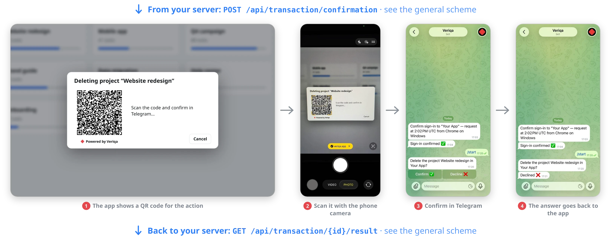
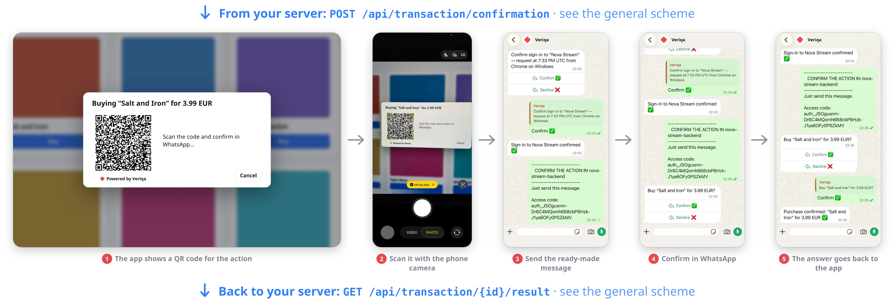
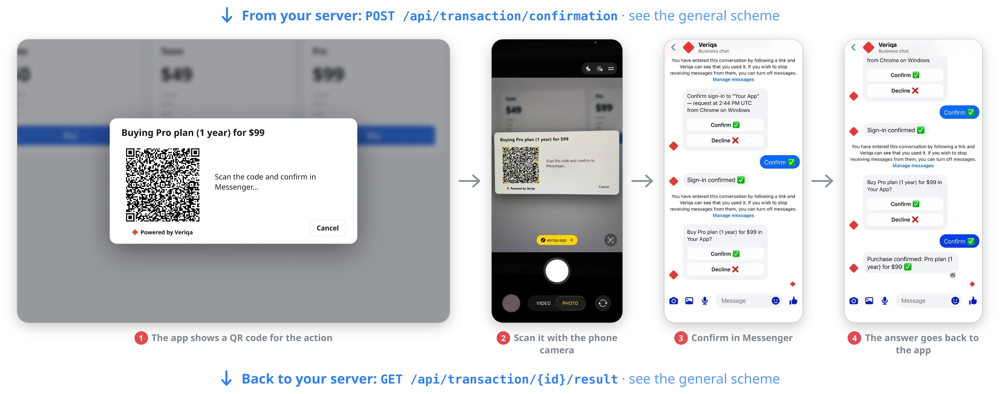

# AI agent approval for Python, Node.js, Go, PHP and ASP.NET Core — human-in-the-loop approval in Telegram

An AI agent asks a person to approve an action before it runs. The person reads the question in
Telegram on their phone ("The support agent wants to refund 89.00 EUR for order A-1042: The
headphones arrived broken. Allow it?") and answers with one tap. Until then the action is held; a
refusal, or no answer in time, means it never runs.

The sample pairs a support agent, written in each of these languages, with the
[Veriqa](https://veriqa.app) approval server from its published Docker image. The agent calls Veriqa over a plain
HTTPS API, so the same gate fits any stack and any agent framework.

<p align="center">
  <br />
  <sub>What the person sees, shown on deleting a project; in this sample the request is a refund.</sub>
</p>

## What you get

The agent handles a refund ticket with a fixed set of three tools, like any agent a team builds
for a single job:

| Tool | Approval |
|---|---|
| `lookup_order` | none — it only reads |
| `refund_payment` | every call: a person approves it in Telegram, with the amount and the order in front of them |
| `send_customer_email` | none in this example |

Open the page, click **Hand the ticket to the agent** and watch the agent's log. The agent looks the order
up, then stops at `refund_payment` and the page shows a QR code. Scan it with a phone that has
Telegram and confirm: the refund runs, and the log names who approved it. Run it again and decline:
the refund does not run, and the agent emails the customer to say a colleague will be in touch.

**The agent does not write the question.** The wording is declared on the Veriqa server for the
action type `approve-refund`, and the agent supplies only the typed values — the amount, the order,
the reason — that the server checks against the declaration. An agent cannot word the question to
its own advantage.

**The gate is in the tool, not in the prompt.** The approval policy is part of the tool's
definition, and the call goes through the gate before the tool's code runs. Nothing the model outputs
can bypass it.

```
built-in/            the stand with the Telegram channel built into Veriqa
  docker-compose.yml   Veriqa from the published image, Telegram channel only
  veriqa.json          the client support-agent and its action type approve-refund
  .env.example         the values you fill in
clients/             the agent, one per language - run any of them
  page/                the page every client serves
  python/              Flask, requests
  node/                Express, in TypeScript
  go/                  net/http
  php/                 the PHP built-in server, curl
  dotnet/              ASP.NET Core
```

## Before you start

- [Docker](https://docs.docker.com/get-docker/) with Compose: the stand runs in it for simplicity.
  Veriqa also runs without Docker, [as an OS service](https://veriqa.app/docs/quickstart/os-service)
- the runtime of the client you pick: Python 3.10+, Node.js 24.5+, Go 1.26+, PHP 8.2+ with the curl
  extension, or the [.NET SDK 10](https://dotnet.microsoft.com/download)
- a Telegram bot: create one with [@BotFather](https://t.me/BotFather) and keep its token. Use a
  bot no other server is polling — Telegram hands the updates to one poller only.

No public address is needed: the stand runs Telegram in polling mode, so the bot fetches its own
updates.

## Run it

**1. Fill in the settings.**

```bash
cd built-in
cp .env.example .env
```

Put your bot token into `TELEGRAM_BOT_TOKEN`, a long random string into `CLIENT_SECRET` and any
password into `CERT_PASSWORD`. The clients read `CLIENT_SECRET` from the same file.

**2. Create the HTTPS certificate.** Veriqa's token endpoint accepts HTTPS only, even locally:
the stand serves it at `https://localhost:8443`.

```bash
docker compose run --rm certificate
```

The clients find `certs/localhost.crt` on their own and trust it for this address only. Your browser
never opens Veriqa, so it shows no warning.

**3. Start Veriqa.**

```bash
docker compose up -d
docker compose ps
```

Wait until the status reads `healthy`.

**4. Start the agent.**

Python:

```bash
cd ../clients/python
python3 -m venv .venv
.venv/bin/pip install -r requirements.txt
.venv/bin/python main.py
```

On Windows, run `python -m venv .venv`; the virtual environment's programs are in `.venv\Scripts\`.

Node.js:

```bash
cd ../clients/node
npm install
npm start
```

Go:

```bash
cd ../clients/go
go run .
```

PHP:

```bash
cd ../clients/php
php -S localhost:7040 index.php
```

ASP.NET Core:

```bash
dotnet run --project ../clients/dotnet
```

**5. Approve.** Open `http://localhost:7040`, click **Hand the ticket to the agent**, scan the QR code
with your phone, tap **Start** in the bot and answer.

## How it fits together

1. The agent's backend gets a token of its own: `POST /connect/token` with
   `grant_type=client_credentials`.
2. A call to `refund_payment` becomes a confirmation: `POST /api/transaction/confirmation` with
   `action_type: approve-refund` and the call's arguments in `slot_values`. Veriqa answers with
   `channel_entry` — the Telegram link and its QR code as a PNG.
3. The page polls the backend, and the backend reads `GET /api/transaction/{id}/result` until the
   outcome is no longer `pending`. Only `confirmed` lets the tool run.
4. On `confirmed` the backend exchanges the transaction once for an `id_token`
   (`grant_type=urn:veriqa:params:oauth:grant-type:confirmation`) and logs who approved it — the
   audit trail of the run.

`built-in/veriqa.json` declares the client `support-agent` with `AllowClientCredentials`,
`AllowConfirmationTokenGrant` and the action type `approve-refund` — its slots and wordings. An action
type is declared in the client entry: one the client does not declare is refused with
`action_type_unknown`. The stand runs in the `Development` environment: tokens and transactions live
in memory, so they are lost on restart. It is a local stand, not a deployment.

## Other channels, such as WhatsApp

Telegram is only the channel this stand starts with. To ask through WhatsApp or another channel as well,
add its settings as [Channels](https://veriqa.app/docs/guides/channels#whatsapp) describes: the section
`Veriqa:Channels:WhatsApp` goes in `built-in/veriqa.json`, its secrets through `.env` and
`built-in/docker-compose.yml`, the same way as the Telegram token. The agent's code does not change:
with more than one channel on, `channel_entry` leads to a Veriqa page where the person picks a channel.
WhatsApp delivers the answers to a webhook, so the stand then needs a public HTTPS address.

<p align="center">
  <br />
  <sub>In WhatsApp the person first sends a ready-made message, then confirms.</sub>
</p>

<p align="center">
  <br />
  <sub>A purchase confirmed in Messenger: a $99 plan, one tap.</sub>
</p>

## Going further

- Approving AI-agent actions, the scenario in full: [veriqa.app/docs/scenarios/agent-approvals](https://veriqa.app/docs/scenarios/agent-approvals)
- The confirmation API: [veriqa.app/docs/reference/confirmation-api](https://veriqa.app/docs/reference/confirmation-api)
- The same gate for Claude Code, as a plugin: [github.com/veriqa/claude-code-approval](https://github.com/veriqa/claude-code-approval)
- Telegram channel settings, including the webhook mode for a deployed server:
  [Channels → Telegram](https://veriqa.app/docs/guides/channels#telegram). Veriqa can also ask through
  WhatsApp, Instagram, Messenger, other channels or Email.
- A production setup with a database, real certificates and a reverse proxy:
  [Quickstart self-hosted](https://veriqa.app/docs/quickstart/self-hosted).
- Veriqa itself — the source, the other samples and the documentation:
  [gitlab.com/veriqa/veriqa](https://gitlab.com/veriqa/veriqa) · [veriqa.app](https://veriqa.app).

## License

This sample is MIT-licensed — copy it into your own code freely. Veriqa itself is open source under
MPL-2.0.
