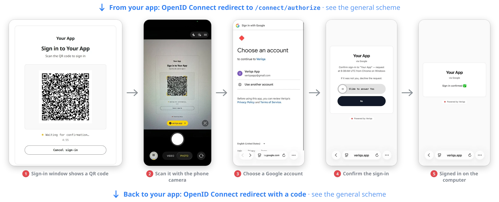
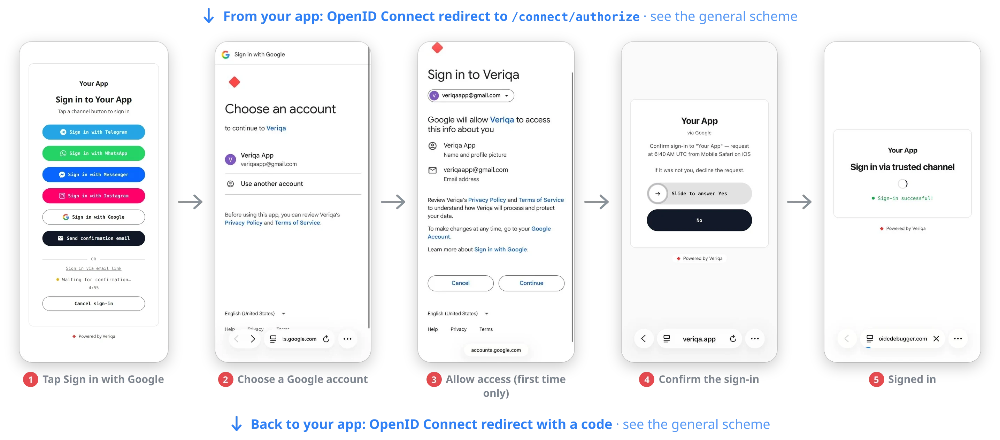

# QR code login with Google, Apple or HUAWEI ID for Python, Node.js, Go, PHP and ASP.NET Core — OpenID Connect (OIDC)

Your users sign in on a computer with their Google, Apple or HUAWEI ID account: they scan a QR code with the phone camera,
sign in to the account on the phone and confirm there. Nobody types a password on the computer, and your Python, Node.js,
Go, PHP or ASP.NET Core app gets standard OpenID Connect (OIDC) tokens. The tokens come from [Veriqa](https://veriqa.app),
an open-source OpenID Connect provider you run yourself.

<p align="center">
  <br />
  <sub>Signing in on a computer: a QR code, the phone camera, a Google account, one swipe on the confirmation page.</sub>
</p>

<p align="center">
  <br />
  <sub>Signing in on the phone itself: a channel button, a Google account, one swipe on the confirmation page.</sub>
</p>

## What you get

Open the client app and it sends you to the Veriqa sign-in page. The page shows a QR code and a button for each enabled
provider. Scan the QR code with your phone or click the button, sign in to your account and answer **Yes** on the
confirmation page. The sign-in window on the computer takes you back to the app, signed in, with the list of claims
Veriqa issued.

Each provider is a channel of the adapter built into Veriqa. The sample has no OAuth code of its own: the protocol of each
provider comes from the [`OpenIddict.Client.WebIntegration`](https://documentation.openiddict.com/integrations/web-providers)
package, and a provider turns on when its client ID is set in `.env`. Turn on one, two or all three. The same adapter
connects Yandex, VK ID, Microsoft and other OpenIddict providers — see
[Sign-in with a provider account](https://veriqa.app/docs/guides/channels#sign-in-with-a-provider-account).

The clients know nothing about Veriqa: each one uses a stock OpenID Connect library for its language (Authorization
Code + PKCE), so the same setup works for any stack with an OIDC library.

```
built-in/            the stand with the provider sign-in built into Veriqa
  docker-compose.yml   Veriqa from the published image with Google, Apple and HUAWEI ID channels
  .env.example         the values you fill in
clients/             the client app, one per language - run any of them
  python/              Flask, Authlib
  node/                Express, openid-client, in TypeScript
  go/                  net/http, go-oidc
  php/                 jumbojett/openid-connect-php
  dotnet/              ASP.NET Core, Microsoft.AspNetCore.Authentication.OpenIdConnect
```

## Before you start

- [Docker](https://docs.docker.com/get-docker/) with Compose: the stand runs in it for simplicity. Veriqa also runs
  without Docker, [as an OS service](https://veriqa.app/docs/quickstart/os-service)
- the runtime of the client you pick: Python 3.10+, Node.js 24.5+, Go 1.26+, PHP 8.2+ with
  [Composer](https://getcomposer.org/), or the [.NET SDK 10](https://dotnet.microsoft.com/download)
- a client registered with at least one provider — see the next section

## Register with a provider

The provider sends the user back to `{PUBLIC_BASE_URL}/auth/web-provider/{channel}/callback`. Without a tunnel,
`PUBLIC_BASE_URL` is `https://localhost:8443`.

| Provider | What to register | What goes into `.env` | Return address |
| --- | --- | --- | --- |
| Google | an OAuth client of the "Web application" type in [Google Cloud](https://developers.google.com/identity/openid-connect/openid-connect), with the return address under "Authorized redirect URIs" | `GOOGLE_CLIENT_ID`, `GOOGLE_CLIENT_SECRET` | `…/auth/web-provider/google/callback` |
| Apple | a Services ID associated with an App ID that has Sign in with Apple enabled, its domain and return address, and a private key ([Apple: configure Sign in with Apple for the web](https://developer.apple.com/help/account/capabilities/configure-sign-in-with-apple-for-the-web)) | `APPLE_CLIENT_ID` (the Services ID), `APPLE_TEAM_ID`, `APPLE_KEY_ID`, `APPLE_PRIVATE_KEY` (the text of the `.p8` file) | `…/auth/web-provider/apple/callback` |
| HUAWEI ID | a web app in AppGallery Connect with Account Kit enabled ([Huawei: obtaining an access token](https://developer.huawei.com/consumer/en/doc/HMSCore-Guides/web-get-access-token-0000001050048946)) | `HUAWEI_CLIENT_ID`, `HUAWEI_CLIENT_SECRET` | `…/auth/web-provider/huawei/callback` |

The return address must match the registered one exactly, scheme, case and trailing slash included. Put the Apple key
into `.env` as one line in double quotes, with `\n` for each line break; `.env.example` shows the format.

Apple does not accept `localhost` or an IP address as a return address
([Apple: request an authorization](https://developer.apple.com/documentation/signinwithapple/incorporating-sign-in-with-apple-into-other-platforms)),
so for Apple start with a [tunnel](#sign-in-from-a-phone) right away. Google accepts `https://localhost:8443`.

## Run it

**1. Fill in the settings.**

```bash
cd built-in
cp .env.example .env
```

Pick any password for `CERT_PASSWORD` and set the credentials of the providers you turn on. Leave `PUBLIC_BASE_URL`
empty for now.

**2. Create the HTTPS certificate.** OpenID Connect needs HTTPS even locally: Veriqa serves it at
`https://localhost:8443`.

For the Python, Node.js, Go and PHP clients, let the stand create a self-signed certificate:

```bash
docker compose run --rm certificate
```

The clients find it in `certs/` on their own. Your browser warns about it when the sign-in page first
opens: choose to proceed.

For the ASP.NET Core client, use the .NET development certificate, which also serves the client at
`https://localhost:7020`:

```bash
dotnet dev-certs https --trust
dotnet dev-certs https -ep certs/localhost.pfx -p <CERT_PASSWORD from .env>
chmod 644 certs/localhost.pfx
```

`--trust` makes your machine trust the certificate; on Linux follow what the command prints. The
`chmod` (Linux and macOS) lets the non-root user of the container read the file; on Windows skip it
and write the path as `certs\localhost.pfx`.

The stand holds one certificate at a time. To switch between the two kinds, delete `certs/` first (with
`sudo` on Linux, the container created it) and recreate the Veriqa container with `docker compose up -d --force-recreate`.

**3. Start Veriqa.**

```bash
docker compose up -d
docker compose ps
```

Wait until the `veriqa` service reads `healthy`, then check that it is ready:
`https://localhost:8443/health/ready` answers `200`. A mistake in the settings of an enabled provider stops Veriqa at
startup, and the message in `docker compose logs veriqa` names the key.

**4. Start the client.**

Python:

```bash
cd ../clients/python
python3 -m venv .venv
.venv/bin/pip install -r requirements.txt
.venv/bin/python main.py
```

On Windows, run `python -m venv .venv`; the virtual environment's programs are in `.venv\Scripts\`.

Node.js:

```bash
cd ../clients/node
npm install
npm start
```

Go:

```bash
cd ../clients/go
go run .
```

PHP:

```bash
cd ../clients/php
composer install
php -S localhost:7020 index.php
```

ASP.NET Core:

```bash
dotnet run --project ../clients/dotnet
```

**5. Sign in.** Open `http://localhost:7020` (`https://` for the ASP.NET Core client). On the sign-in page, click a
provider button: the provider opens in a new tab. Sign in to your account and click **Yes**. The sign-in window takes you
back to the client with the list of your claims. `/signout` drops the local session so you can go again.

## Sign in from a phone

The QR code points at the address in `PUBLIC_BASE_URL`, and a phone cannot reach the `localhost` of your computer. To sign
in by scanning the QR code with a phone, and for Apple in any case, start an HTTP tunnel with a public HTTPS address to
`https://localhost:8443`. For example, a
[Cloudflare quick tunnel](https://developers.cloudflare.com/cloudflare-one/networks/connectors/cloudflare-tunnel/do-more-with-tunnels/trycloudflare/),
which needs no account:

```bash
cloudflared tunnel --url https://localhost:8443 --no-tls-verify
```

`--no-tls-verify` is there because the certificate of the stand is self-signed. Any other tunnel works too.

Then:

1. Put the tunnel address into `PUBLIC_BASE_URL` in `.env`, for example `PUBLIC_BASE_URL=https://example.trycloudflare.com`.
2. With the provider, register the return address on the tunnel host:
   `https://example.trycloudflare.com/auth/web-provider/google/callback`.
3. Restart Veriqa with `docker compose up -d`.

The computer and the client keep using `https://localhost:8443`: only the phone and the provider go through the tunnel.
A quick tunnel gets a new address on every start, so repeat steps 1–3 each time you restart it.

## What to keep in mind

- **The Yes/No question protects against someone else's QR code.** Without it, a QR code of someone else's sign-in that
  the user scans would complete that sign-in under the user's account. Where the question is asked is set by
  [`Veriqa:LoginConfirmation:Mode`](https://veriqa.app/docs/reference/configuration#veriqaloginconfirmation); more in
  [Sign in with a provider account, confirmed on the phone](https://veriqa.app/docs/scenarios/provider-account-sign-in).
- **Scan the QR code with the system camera, not inside a messaging app.** A link opened in an app's built-in browser
  reaches Google in an embedded user agent, and Google refuses the sign-in with `disallowed_useragent`
  ([Google: OAuth 2.0 policies](https://developers.google.com/identity/protocols/oauth2/policies)).
- **Apple sends no name, and the email may be a relay address** that forwards to the real one
  ([Apple: private email relay service](https://developer.apple.com/documentation/signinwithapple/communicating-using-the-private-email-relay-service)).
  Treat it as a contact address, not as an identifier.
- **The channel name is part of `sub`.** `sub` has the form `{channel}:{the user's identifier at the provider}`, for
  example `google:1234567890` (a synthetic example), so renaming a channel changes the `sub` of every user who signed in
  through it.

## How it fits together

- `built-in/docker-compose.yml` registers the client (`rp`, redirects `http://localhost:7020/signin-oidc` and
  `https://localhost:7020/signin-oidc`), sets the issuer to `https://localhost:8443` and describes three channels:
  `google`, `apple` and `huawei`. A channel turns on when its client ID is set.
- The clients ask for a sign-in without naming a channel, so the sign-in page offers every enabled one. To go straight to
  one provider, pass `--Oidc:Channel google` to `clients/dotnet/` or set `VERIQA_CHANNEL=google` for the other clients:
  the client then sends `acr_values=channel:google`.
- The stand runs in the `Development` environment: sessions live in memory and tokens are signed
  with development certificates, so a restart forgets everything — it is a local stand, not a
  deployment.

## Going further

- Every key of the channel, the starting providers and the other OpenIddict providers:
  [Sign-in with a provider account](https://veriqa.app/docs/guides/channels#sign-in-with-a-provider-account).
- A production setup with a database, real certificates and a reverse proxy:
  [Quickstart self-hosted](https://veriqa.app/docs/quickstart/self-hosted).
- Veriqa itself — the source, the other samples and the documentation:
  [gitlab.com/veriqa/veriqa](https://gitlab.com/veriqa/veriqa) · [veriqa.app](https://veriqa.app).

## License

This sample is MIT-licensed — copy it into your own code freely. Veriqa itself is open source under
MPL-2.0.
