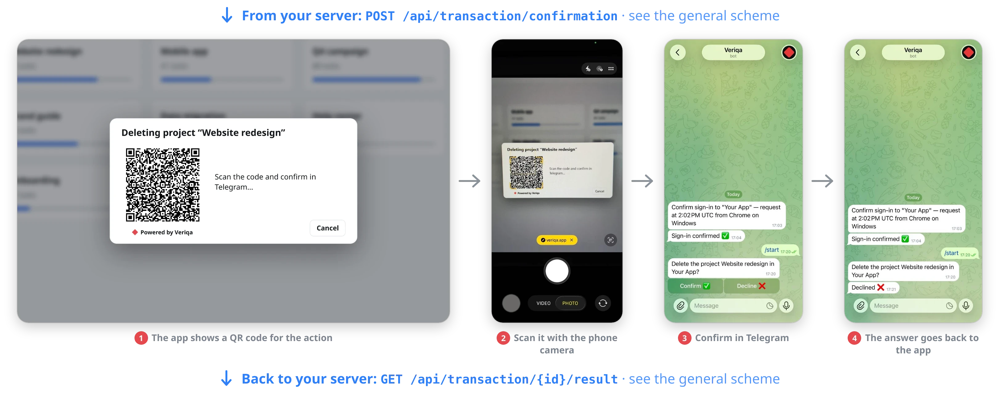
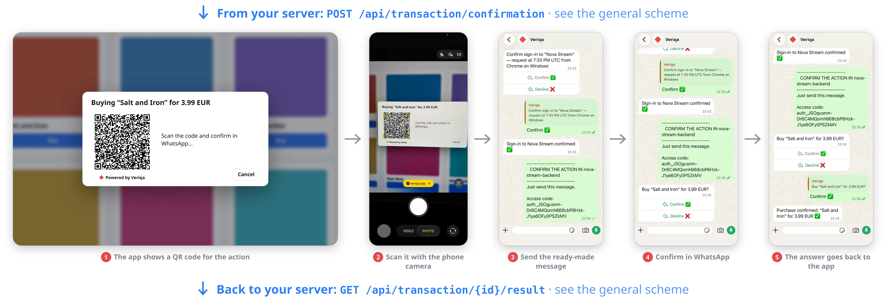
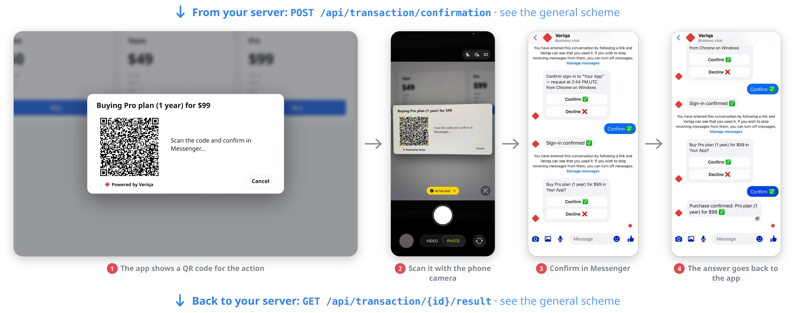

# Step-up authentication and transaction confirmation for Python, Node.js, Go, PHP and ASP.NET Core — in Telegram

Two server-side confirmations that a backend requests from a person in Telegram on their phone, with
no password, no SMS code and no browser redirect:

- **Transaction confirmation**: "Approve a payment of 42.00 EUR to ACME Ltd?" — the backend learns
  the answer and who gave it.
- **Step-up before a destructive action**: "Delete the project Q3 report with its 12 documents? This
  cannot be undone." — the backend deletes the project only when the person who confirmed is the
  **owner of the account**, not just anyone who scanned the code.

The sample pairs a small application, written in each of these languages, with the
[Veriqa](https://veriqa.app) confirmation server from its published Docker image. The application calls Veriqa over a
plain HTTPS API, so the same flow fits any stack.

<p align="center">
  <br />
  <sub>Deleting a project, from the person's side: a QR code, the phone camera, one answer in Telegram.</sub>
</p>

## What you get

Open the page. It has two parts:

1. **Approve a payment.** Click **Ask for approval**, scan the QR code with a phone that has
   Telegram and confirm. The page shows `Outcome: confirmed` and the claims of the person who
   confirmed (`sub`, `channel_type`, `channel_user_id`).
2. **Step-up before deleting a project.** Click **Delete** next to a project, scan the code and
   confirm: the project is deleted and your Telegram account becomes the owner. A real application knows
   the owner from account linking; this example makes the first person who confirms the owner. Delete
   a second project and confirm from another Telegram account: the confirmation succeeds, but the
   page shows
   *Not deleted — confirmed, but not by the owner*. **Forget the owner** starts over.

```
built-in/            the stand with the Telegram channel built into Veriqa
  docker-compose.yml   Veriqa from the published image, Telegram channel only
  veriqa.json          the client sample-app and its action types
  .env.example         the values you fill in
clients/             the application, one per language - run any of them
  page/                the page every client serves
  python/              Flask, requests
  node/                Express, in TypeScript
  go/                  net/http
  php/                 the PHP built-in server, curl
  dotnet/              ASP.NET Core
```

## Before you start

- [Docker](https://docs.docker.com/get-docker/) with Compose: the stand runs in it for simplicity.
  Veriqa also runs without Docker, [as an OS service](https://veriqa.app/docs/quickstart/os-service)
- the runtime of the client you pick: Python 3.10+, Node.js 24.5+, Go 1.26+, PHP 8.2+ with the curl
  extension, or the [.NET SDK 10](https://dotnet.microsoft.com/download)
- a Telegram bot: create one with [@BotFather](https://t.me/BotFather) and keep its token. Use a
  bot no other server is polling — Telegram hands the updates to one poller only.
- a second Telegram account, to try the step-up check with someone other than the owner.

No public address is needed: the stand runs Telegram in polling mode, so the bot fetches its own
updates.

## Run it

**1. Fill in the settings.**

```bash
cd built-in
cp .env.example .env
```

Put your bot token into `TELEGRAM_BOT_TOKEN`, a long random string into `CLIENT_SECRET` and any
password into `CERT_PASSWORD`. The clients read `CLIENT_SECRET` from the same file.

**2. Create the HTTPS certificate.** Veriqa's token endpoint accepts HTTPS only, even locally:
the stand serves it at `https://localhost:8443`.

```bash
docker compose run --rm certificate
```

The clients find `certs/localhost.crt` on their own and trust it for this address only. Your browser
never opens Veriqa, so it shows no warning.

**3. Start Veriqa.**

```bash
docker compose up -d
docker compose ps
```

Wait until the status reads `healthy`.

**4. Start the application.**

Python:

```bash
cd ../clients/python
python3 -m venv .venv
.venv/bin/pip install -r requirements.txt
.venv/bin/python main.py
```

On Windows, run `python -m venv .venv`; the virtual environment's programs are in `.venv\Scripts\`.

Node.js:

```bash
cd ../clients/node
npm install
npm start
```

Go:

```bash
cd ../clients/go
go run .
```

PHP:

```bash
cd ../clients/php
php -S localhost:7030 index.php
```

ASP.NET Core:

```bash
dotnet run --project ../clients/dotnet
```

**5. Confirm.** Open `http://localhost:7030`, start either part, scan the QR code with your phone,
tap **Start** in the bot and answer.

## How it fits together

Both parts use the same call sequence:

1. `POST /connect/token` with `grant_type=client_credentials` — the backend's own token.
2. `POST /api/transaction/confirmation` with the action type and its `slot_values`: `approve-payment`
   (amount, payee) or `delete-project` (project, document count). Veriqa answers with `channel_entry` —
   the Telegram link and its QR code as a PNG.
3. Poll `GET /api/transaction/{id}/result` until the outcome is no longer `pending`.
4. On `confirmed`, when the backend needs to know who confirmed, it exchanges the transaction once
   for an `id_token` (`grant_type=urn:veriqa:params:oauth:grant-type:confirmation`).

The step-up adds one thing. Once an owner is known, the deletion request names them:
`expected_identities: { "telegram_user_id": "<owner>" }`. Veriqa compares it with the
`channel_user_id` of the person who confirmed and answers with `matched_type`. It does not reject a
mismatch on its own: the result still says `confirmed`, with `matched_type: null`. The backend deletes
only on `confirmed` **and** `matched_type: telegram_user_id` — that check is the step-up.

`built-in/veriqa.json` declares the client `sample-app` with `AllowClientCredentials`,
`AllowConfirmationTokenGrant`, both action types with their slots and wordings, and
`IdentityMatchComparableTypes` — the `telegram_user_id` the step-up compares. Without that
declaration a request naming it is refused with `candidate_type_undeclared`. It is a Telegram id only
because the stand enables Telegram alone; with several channels, compare an identity that does not
depend on the channel. The stand runs in the `Development` environment: tokens and transactions live
in memory, so they are lost on restart. It is a local stand, not a deployment.

## Other channels, such as WhatsApp

Telegram is only the channel this stand starts with. To ask through WhatsApp or another channel as well,
add its settings as [Channels](https://veriqa.app/docs/guides/channels#whatsapp) describes: the section
`Veriqa:Channels:WhatsApp` goes in `built-in/veriqa.json`, its secrets through `.env` and
`built-in/docker-compose.yml`, the same way as the Telegram token. The application's code does not
change: with more than one channel on, `channel_entry` leads to a Veriqa page where the person picks a
channel. WhatsApp delivers the answers to a webhook, so the stand then needs a public HTTPS address. The
step-up compares `telegram_user_id`, so with a second channel on, compare an identity that does not
depend on the channel (see above).

<p align="center">
  <br />
  <sub>In WhatsApp the person first sends a ready-made message, then confirms.</sub>
</p>

<p align="center">
  <br />
  <sub>A purchase confirmed in Messenger: a $99 plan, one tap.</sub>
</p>

## Going further

- The confirmation API: [veriqa.app/docs/reference/confirmation-api](https://veriqa.app/docs/reference/confirmation-api)
- Linking a user's account to their channel from your server, which tells the step-up who the owner
  is: [veriqa.app/docs/scenarios/channel-linking](https://veriqa.app/docs/scenarios/channel-linking)
- Telegram channel settings, including the webhook mode for a deployed server:
  [Channels → Telegram](https://veriqa.app/docs/guides/channels#telegram). Veriqa can also ask through
  WhatsApp, Instagram, Messenger, other channels or Email.
- A production setup with a database, real certificates and a reverse proxy:
  [Quickstart self-hosted](https://veriqa.app/docs/quickstart/self-hosted).
- Veriqa itself — the source, the other samples and the documentation:
  [gitlab.com/veriqa/veriqa](https://gitlab.com/veriqa/veriqa) · [veriqa.app](https://veriqa.app).

## License

This sample is MIT-licensed — copy it into your own code freely. Veriqa itself is open source under
MPL-2.0.
